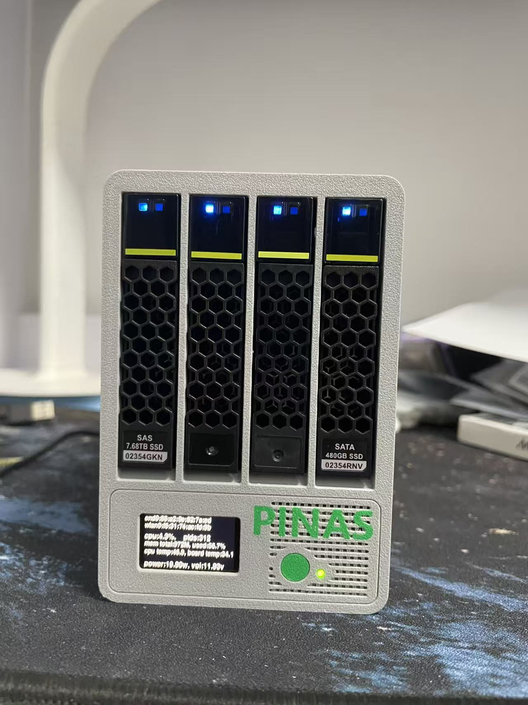
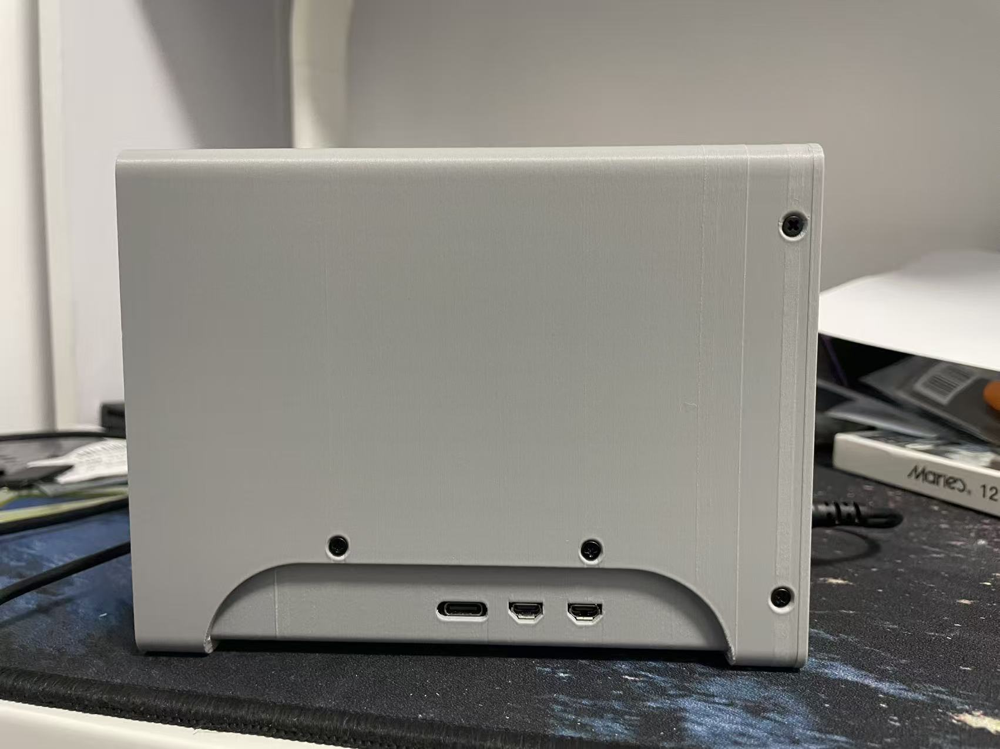
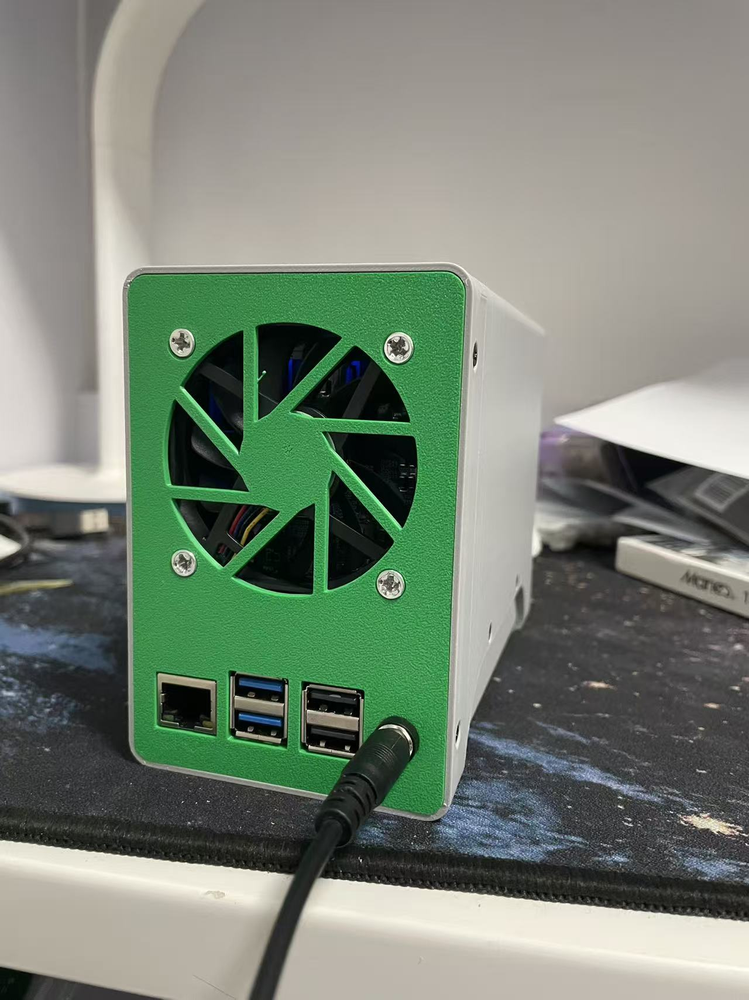
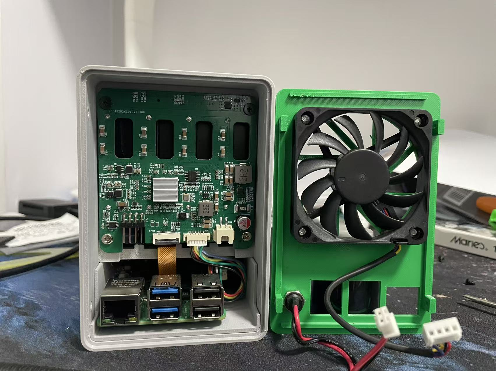

# PINAS

## 简介

PINAS 支持树莓派5、RAXDA Rock2A、RAXDA Rock4D、RAXDA Rock5C开发板。

支持飞牛NAS系统（FN-OS），下载地址：<https://fnnas.com/download-arm>

[安装配置](#安装指南)

[购买链接](<https://www.goofish.com/item?spm=a21ybx.search.searchFeedList.1.65e033bbsNMF3L&id=877258687346&categoryId=126856550>)






## 安装指南

### 1. 准备系统和依赖

先为开发板安装对应的 FN-OS ARM 系统，完成首次启动和网络配置，然后通过 SSH 或本地终端登录。以下命令在开发板上执行。

安装脚本需要 Bash、设备树编译器 `dtc`；树莓派配置还需要 Python 3。使用 `apt` 的系统可执行：

```shell
sudo apt update
sudo apt install -y git device-tree-compiler python3
```

脚本会写入启动分区，需要使用 `sudo`，并确保启动分区可写。树莓派使用 `/boot/firmware/overlays/` 和 `/boot/firmware/config.txt`，Rock 系列使用 `/boot/overlays/`。如果系统中的路径不同，请先确认系统的设备树加载方式。

### 2. 下载项目

```shell
git clone https://github.com/zengqingzheng/pinas.git
cd pinas
```

如果 GitHub 无法访问，可以使用镜像：[https://gitee.com/zengqingzheng/pinas.git](https://gitee.com/zengqingzheng/pinas.git)。

为安装脚本添加执行权限：

```shell
sudo chmod +x install.sh
```

后续安装命令均在 `pinas` 项目根目录执行。
#### 树莓派 5：先开启 PCIe

安装树莓派 5 配置前，请确认 PCIe 已在启动配置中启用。运行 `sudo rpi-eeprom-config --edit`：

```shell
sudo rpi-eeprom-config --edit
```

在文件末尾添加以下配置（如果已有相同配置则不要重复添加）：

```ini
BOOT_ORDER=0xf416
PCIE_PROBE=1
```

其中 PCIE_PROBE=1 用于从非 HAT+ 设备探测 PCIe 存储设备。保存后重启树莓派使配置生效：

```shell
sudo reboot
```

重新登录后再执行树莓派 5 的安装命令。安装脚本也会检查并写入上述 PCIe 配置；提前配置并重启可以先确认 PCIe 已正常启用。

### 3. 选择开发板并安装

`-b` 指定开发板，参数必须与实际硬件一致：

| 开发板 | board 参数 | 安装命令 |
| --- | --- | --- |
| 树莓派 5 | `rpi5` | `sudo ./install.sh -b rpi5` |
| Radxa ROCK 2A | `rock2a` | `sudo ./install.sh -b rock2a` |
| Radxa ROCK 4D | `rock4d` | `sudo ./install.sh -b rock4d` |
| Radxa ROCK 5C | `rock5c` | `sudo ./install.sh -b rock5c` |

只需执行对应开发板的一条命令。例如 ROCK 2A：

```shell
sudo ./install.sh -b rock2a
```

也支持 `--board rock2a` 和 `--board=rock2a`。不指定参数时默认安装树莓派 5 配置。查看帮助：

```shell
./install.sh --help
```

安装脚本会编译对应的 `pinas-sensors.dts`，并复制生成的 `pinas-sensors.dtbo` 到启动分区。

- **树莓派 5**：先将 `/boot/firmware/config.txt` 备份到 `config.txt.bak`，再配置 I²C、SPI、PCIe 和 `pinas-sensors` overlay。重复安装会覆盖该备份，如需保留原始配置，请另行备份。
- **Rock 系列**：如果对应的 I²C/SPI overlay 存在 `.dtbo.disabled` 文件，脚本会将其恢复为 `.dtbo`；源文件不存在时跳过。脚本只复制 PINAS overlay 并恢复这些文件名，不会自动修改启动配置。请使用系统提供的 `rsetup` 或启动配置方式，确认所需 I²C/SPI 及 `pinas-sensors` overlay 已启用。

手动配置可参考 [设备树 overlay 说明](overlays/README.md)。

### 4. 重启并检查

先检查安装输出中是否有编译、复制或配置错误；脚本末尾的成功提示不能代替这些检查。确认无误后重启：

```shell
sudo reboot
```

重新登录后，检查 overlay 文件和内核日志：

```shell
# 树莓派 5
ls -l /boot/firmware/overlays/pinas-sensors.dtbo

# Rock 系列
ls -l /boot/overlays/pinas-sensors.dtbo

# 查看传感器和风扇驱动相关日志
sudo dmesg | grep -Ei 'pinas|lm75|ina226|emc2301|fan|thermal'
```

overlay 文件存在仅表示已经复制，是否加载成功还需结合启动配置、内核日志及实际温度读取、风扇运行情况判断。

### 5. 安装 SPI 显示屏（可选）

`display` 程序不依赖 Pillow，使用 NumPy 和内置点阵字库显示状态信息。显示屏安装脚本的第一个参数用于选择板型：

```shell
cd display
sudo bash ./install.sh rock2a
```

可选参数为 `rpi5`、`rock2a`、`rock4d` 和 `rock5c`。各板型的 SPI、CS、DC、RST、背光引脚集中在 `display/install.sh` 生成的 `config.py` 中；安装前请根据实际接线修改对应板型的配置。默认值沿用当前树莓派接线示例。

### 常见问题

- **`dtc: command not found`**：安装 `device-tree-compiler` 后重新执行。
- **提示必须以 root 运行**：在安装命令前添加 `sudo`。
- **`unsupported board`**：使用上表中的小写参数，可通过 `--help` 查看支持列表。
- **提示启动目录或配置文件不存在**：核对当前系统的启动分区挂载位置，不要仅创建空目录后继续安装。
- **重启后没有传感器或风扇功能**：确认选择了正确板型、overlay 已启用，并检查硬件连接、内核驱动和 `dmesg` 中的错误。
