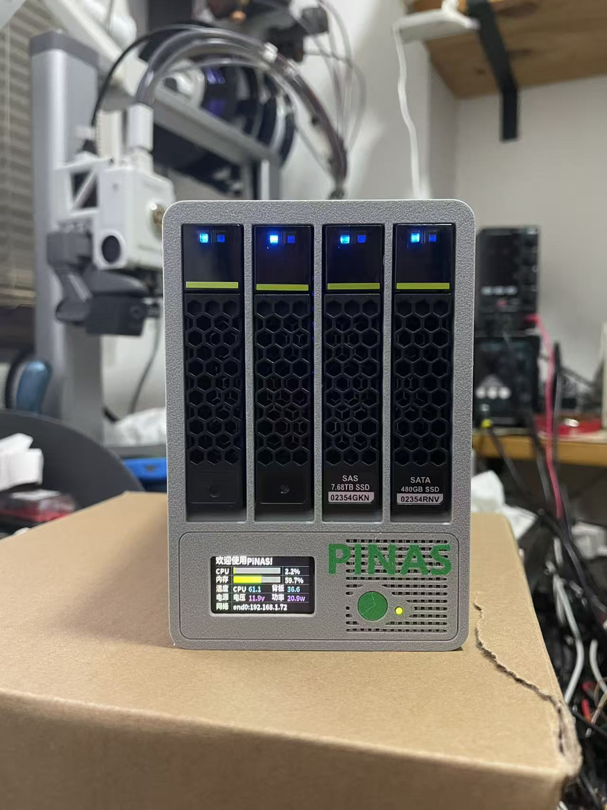
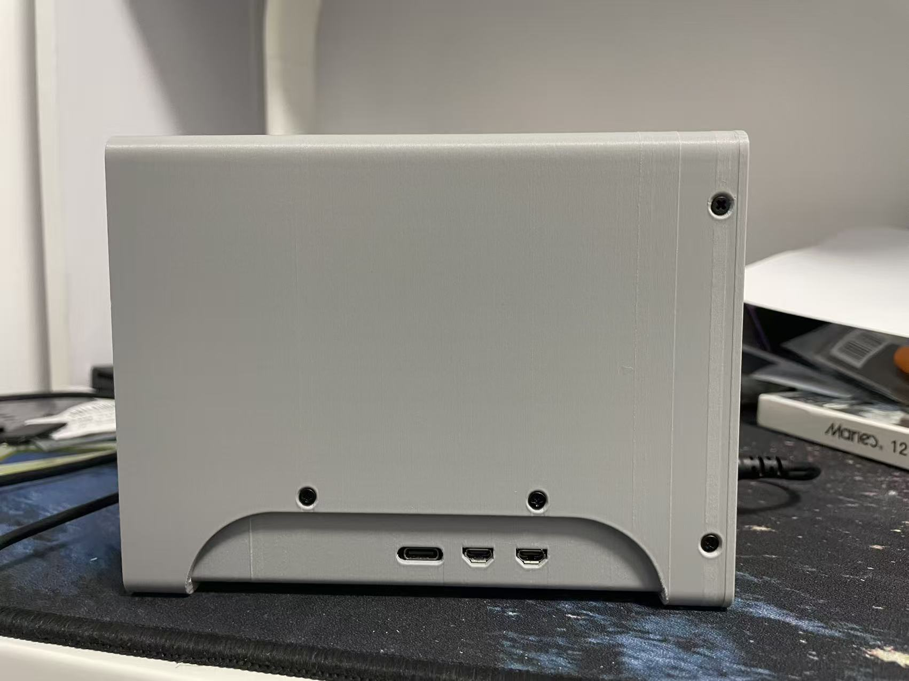
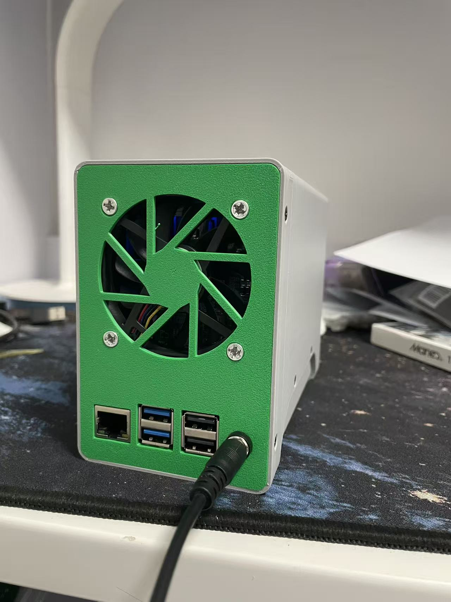
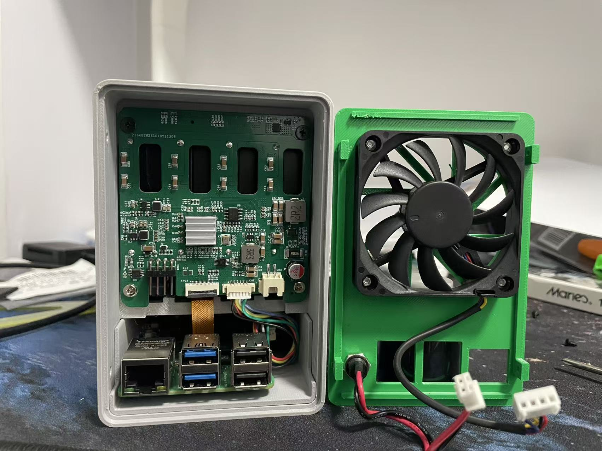
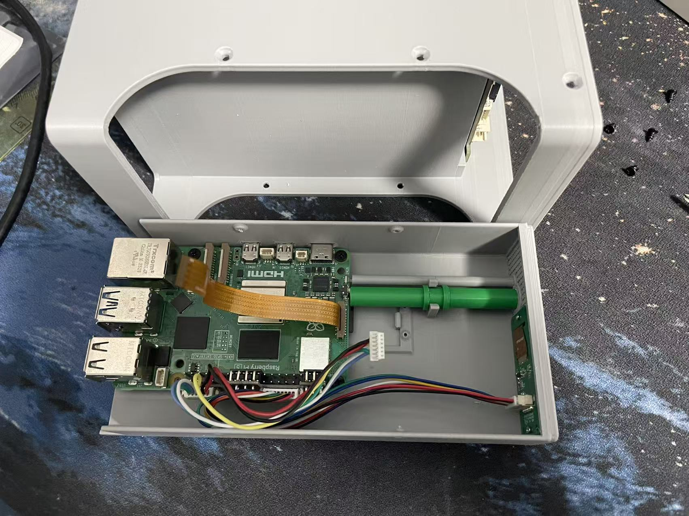
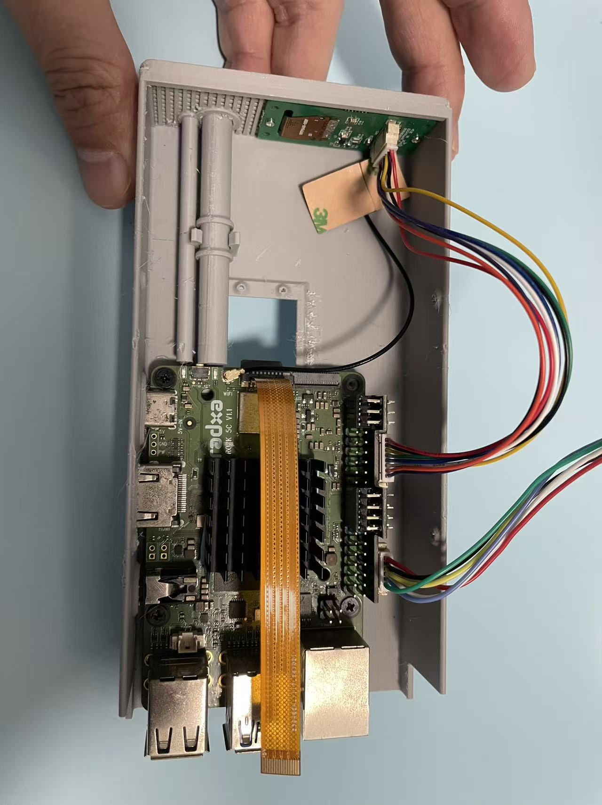
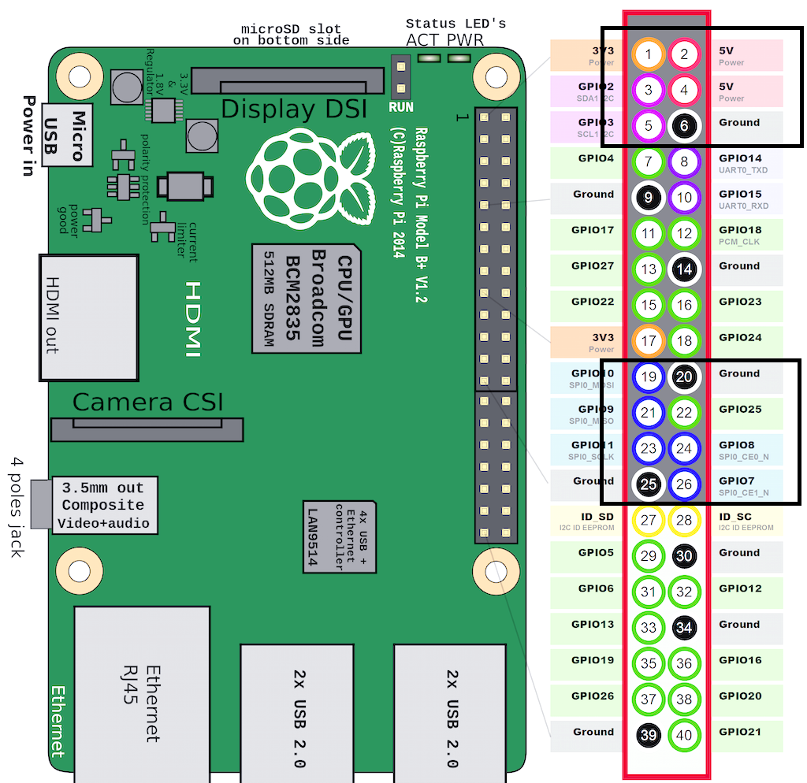

# PINAS

## 简介

PINAS 支持树莓派5、RAXDA Rock2A、RAXDA Rock4D、RAXDA Rock5C开发板。

支持飞牛NAS系统（FN-OS），下载地址：<https://fnnas.com/download-arm>

[安装配置](#安装指南)

[购买链接](<https://www.goofish.com/item?spm=a21ybx.search.searchFeedList.1.65e033bbsNMF3L&id=877258687346&categoryId=126856550>)








## 安装指南

### 1. 连接说明

安装前请先完成 PINAS 与开发板的硬件连接。PINAS 使用开发板的 40 针扩展接口连接电源、I²C 传感器和风扇控制器；不同开发板的针脚编号和 I²C 总线不同，必须按实际板型选择接线和安装参数。

#### 主板40P GPIO



#### I²C 传感器

PINAS 的温度传感器（LM75B）和电源监控芯片（INA226）通过 I²C 连接，风扇控制器（EMC2301）也使用同一条总线。连接时对应连接 `SDA`、`SCL`、`3V3` 和 `GND`，并确保 I²C 总线已经启用。设备地址由硬件设计和设备树 overlay 定义，不要随意修改地址或并联地址冲突的器件。[背板接口说明](doc/pinas_m4.pdf)

以树莓派 5 的标准 40 针接口为例：

| 信号 | 物理针脚 | 说明 |
| --- | --- | --- |
| 5V | 2、4 | 5V供电输入 |
| I2C_SDA | 3 | I²C 数据 |
| I2C_SCL | 5 | I²C 时钟 |
| GND | 6、20、25 | 共地 |

Rock 2A、Rock 4D 和 Rock 5C 请以对应开发板丝印、原理图或用户手册中的 40 针接口定义为准。项目中的 overlay 会选择对应的 I²C 控制器，但不会修正错误的物理接线。

#### 风扇和 SPI 显示屏

- SPI 显示屏为可选设备。显示屏的 `SDA`、`SCK`、`RS`、`RES`、`CS`、`BLK`、`3.3V`、`GND` 引脚必须按实际板型配置, SPI屏幕引脚连接说明:

| 信号 | 物理针脚 | 说明 |
| --- | --- | --- |
| SDA | 19 | SPI_MOSI数据引脚 |
| SCK | 23 | SPI_SCK时钟 |
| RS | 22 | SPI屏RS/DC |
| RES | 悬空 | SPI屏硬重启 |
| CS | 24 | SPI_CS片选 |
| BLK | 26 | SPI屏幕背光控制， 高电平有效 |
| 3.3V | 1 | SPI屏供电 |
| GND | 6、20、25 | 共地 |

安装前检查 `display/install.sh` 生成的 `config.py`。

上电前请检查电源极性、3.3 V/5 V 电压等级、I²C 的 `SDA/SCL` 是否接反，以及所有设备是否共地。确认无误后再继续下面的软件安装步骤。

### 2. 准备系统和依赖

先为开发板安装对应的 FN-OS ARM 系统，完成首次启动和网络配置，然后通过 SSH 或本地终端登录。以下命令在开发板上执行。

安装脚本需要 Bash、设备树编译器 `dtc`；树莓派配置还需要 Python 3。使用 `apt` 的系统可执行：

```shell
sudo apt update
sudo apt install -y git device-tree-compiler python3
```

脚本会写入启动分区，需要使用 `sudo`，并确保启动分区可写。树莓派使用 `/boot/firmware/overlays/` 和 `/boot/firmware/config.txt`，Rock 系列使用 `/boot/overlays/`。如果系统中的路径不同，请先确认系统的设备树加载方式。

### 3. 下载项目

```shell
git clone https://github.com/zengqingzheng/pinas.git
cd pinas
```

如果 GitHub 无法访问，可以使用镜像：[https://gitee.com/zengqingzheng/pinas.git](https://gitee.com/zengqingzheng/pinas.git)。

为安装脚本添加执行权限：

```shell
sudo chmod +x install.sh
```

后续安装命令均在 `pinas` 项目根目录执行。

#### 树莓派 5：先开启 PCIe

安装树莓派 5 配置前，请确认 PCIe 已在启动配置中启用。运行 `sudo rpi-eeprom-config --edit`：

```shell
sudo rpi-eeprom-config --edit
```

在文件末尾添加以下配置（如果已有相同配置则不要重复添加）：

```ini
BOOT_ORDER=0xf416
PCIE_PROBE=1
```

其中 PCIE_PROBE=1 用于从非 HAT+ 设备探测 PCIe 存储设备。保存后重启树莓派使配置生效：

```shell
sudo reboot
```

重新登录后再执行树莓派 5 的安装命令。安装脚本也会检查并写入上述 PCIe 配置；提前配置并重启可以先确认 PCIe 已正常启用。

### 4. 选择开发板并安装

`-b` 指定开发板，参数必须与实际硬件一致：

| 开发板 | board 参数 | 安装命令 |
| --- | --- | --- |
| 树莓派 5 | `rpi5` | `sudo ./install.sh -b rpi5` |
| Radxa ROCK 2A | `rock2a` | `sudo ./install.sh -b rock2a` |
| Radxa ROCK 4D | `rock4d` | `sudo ./install.sh -b rock4d` |
| Radxa ROCK 5C | `rock5c` | `sudo ./install.sh -b rock5c` |

只需执行对应开发板的一条命令。例如 ROCK 2A：

```shell
sudo ./install.sh -b rock2a
```

也支持 `--board rock2a` 和 `--board=rock2a`。不指定参数时默认安装树莓派 5 配置。查看帮助：

```shell
./install.sh --help
```

安装脚本会编译对应的 `pinas-sensors.dts`，并复制生成的 `pinas-sensors.dtbo` 到启动分区。

- **树莓派 5**：先将 `/boot/firmware/config.txt` 备份到 `config.txt.bak`，再配置 I²C、SPI、PCIe 和 `pinas-sensors` overlay。重复安装会覆盖该备份，如需保留原始配置，请另行备份。
- **Rock 系列**：如果对应的 I²C/SPI overlay 存在 `.dtbo.disabled` 文件，脚本会将其恢复为 `.dtbo`；源文件不存在时跳过。脚本只复制 PINAS overlay 并恢复这些文件名，不会自动修改启动配置。请使用系统提供的 `rsetup` 或启动配置方式，确认所需 I²C/SPI 及 `pinas-sensors` overlay 已启用。

手动配置可参考 [设备树 overlay 说明](overlays/README.md)。

### 5. 重启并检查

先检查安装输出中是否有编译、复制或配置错误；脚本末尾的成功提示不能代替这些检查。确认无误后重启：

```shell
sudo reboot
```

重新登录后，检查 overlay 文件和内核日志：

```shell
# 树莓派 5
ls -l /boot/firmware/overlays/pinas-sensors.dtbo

# Rock 系列
ls -l /boot/overlays/pinas-sensors.dtbo

# 查看传感器和风扇驱动相关日志
sudo dmesg | grep -Ei 'pinas|lm75|ina226|emc2301|fan|thermal'
```

overlay 文件存在仅表示已经复制，是否加载成功还需结合启动配置、内核日志及实际温度读取、风扇运行情况判断。

### 6. 安装 SPI 显示屏（可选）

SPI 显示屏程序默认已经安装，但如果你需要单独安装可以根据下面说明进行安装：

```shell
git clone https://github.com/lovelycrabs/pinas-display.git
cd pinas-display
sudo bash ./install.sh -b rpi5
```

可选参数为 `rpi5`、`rock2a`、`rock4d` 和 `rock5c`。各板型的 SPI、CS、DC、RST、背光引脚集中在 `pinas-display/install.sh` 生成的 `config.py` 中；安装前请根据实际接线修改对应板型的配置。默认值沿用当前树莓派接线示例。

### 7. 手动配置

`install.sh` 目前主要适配官方提供的系统和启动配置方式。如果使用 Armbian 等第三方系统，启动分区路径、设备树加载方式和 overlay 配置项可能不同，安装脚本可能无法成功执行。此时可以按照下面的步骤手动配置。

#### 1. 开启 I²C 和 SPI

请先按照上面的[连接说明](#1-连接说明)完成硬件连接，并在系统中开启开发板实际使用的 I²C 和 SPI 控制器。不同系统的配置入口可能不同，通常可以使用系统配置工具（例如 `armbian-config`、`rsetup`）启用，也可以按照该系统的启动配置文档修改配置文件。

启用后确认对应设备已经出现：

```shell
ls /dev/i2c-*
ls /dev/spidev*
```

如果设备节点不存在，先检查内核模块、设备树和启动配置，不要继续编译 PINAS overlay。

#### 2. 编译 PINAS 传感器 overlay

在 PINAS 项目根目录执行，`<开发板>` 替换为 `rpi5`、`rock2a`、`rock4d` 或 `rock5c`：

```shell
cd pinas/overlays/<开发板>
dtc -I dts -O dtb -o pinas-sensors.dtbo pinas-sensors.dts
```

例如 ROCK 2A：

```shell
cd pinas/overlays/rock2a
dtc -I dts -O dtb -o pinas-sensors.dtbo pinas-sensors.dts
```

#### 3. 加载 overlay

将生成的 `pinas-sensors.dtbo` 复制到系统的 overlay 目录，并使用系统支持的 `fdtoverlay` 或启动配置方式加载。overlay 目录和基础 DTB 文件的位置会因系统而不同，常见位置包括 `/boot/firmware/overlays/`、`/boot/overlays/`、`/boot/dtbo/` 和 `/boot/dtb/rockchip/overlay/`。

如果系统要求直接合并设备树，可以先备份基础 DTB，再执行类似下面的命令；请根据实际系统替换输入、输出和 overlay 路径：

```shell
sudo fdtoverlay -i /boot/dtb/<基础设备树>.dtb \
  -o /boot/dtb/<基础设备树>-pinas.dtb \
  /boot/dtbo/pinas-sensors.dtbo
```

如果系统通过启动配置文件加载 overlay，则将 `pinas-sensors.dtbo` 放入系统指定的 overlay 目录，并在启动配置中添加对应的 overlay 配置。例如树莓派通常使用：

```ini
dtparam=i2c_arm=on
dtparam=spi=on
dtoverlay=pinas-sensors
```

Rock 系列和 Armbian 的配置项名称及文件位置可能不同，请以当前系统的设备树加载方式为准。完成配置后重启，并按[重启并检查](#5-重启并检查)确认传感器、风扇和 SPI 设备已经正常加载。

#### 4. 安装驱动

有些系统内核、模块缺少(EMC2305、LM75、INA2xx驱动)，需要执行下面命令检查和安装缺失的驱动：

```shell
sudo bash ./scripts/install-driver.sh
```

### 常见问题

- **`dtc: command not found`**：安装 `device-tree-compiler` 后重新执行。
- **提示必须以 root 运行**：在安装命令前添加 `sudo`。
- **`unsupported board`**：使用上表中的小写参数，可通过 `--help` 查看支持列表。
- **提示启动目录或配置文件不存在**：核对当前系统的启动分区挂载位置，不要仅创建空目录后继续安装。
- **重启后没有传感器或风扇功能**：确认选择了正确板型、overlay 已启用，并检查硬件连接、内核驱动和 `dmesg` 中的错误。

## 3D 机箱打印

见[https://makerworld.com/zh/models/1025343-raspberry-pi-5-rock-5c-nas-case-4-plates-2-5-inch#profileId-1007434](https://makerworld.com/zh/models/1025343-raspberry-pi-5-rock-5c-nas-case-4-plates-2-5-inch#profileId-1007434)